<div align="center">

[](#)

> **`$ whoami` → building secure software and learning how to break it (legally).**

[](https://www.linkedin.com/in/isaac-thomas-mathew-bb0345361/)
[](mailto:isaacitmathew@gmail.com)


</div>

---

## `> cat about.txt`

```python
class Isaac:
    def __init__(self):
        self.name     = "Isaac Thomas Mathew"
        self.interest = "Cybersecurity"
        self.skills   = ["Software Development", "Design"]
        self.learning = ["Networking", "Linux", "Web Security"]   # edit me
        self.mindset  = "Think like an attacker, build like a defender."
```

- Short bullet about what you study or do
- Short bullet about what drew you to cybersecurity
- Short bullet about what you're learning right now

---

## `> ls ./tech-stack`

**Languages**


**Security & Systems**


**Dev & Design**


> Keep only the badges that are true for you. Add more from https://shields.io (icon names: https://simpleicons.org).

---

## `> ./security-interests`

| Domain                 | Level      | Details                      |
| ---------------------- | ---------- | ---------------------------- |
| **Networking**         | `Beginner` | TCP/IP, packet analysis      |
| **Linux & Scripting**  | `Beginner` | Python automation            |
| **Web Security**       | `Beginner` | OWASP Top 10                 |
| **Cryptography**       | `Beginner` | Hashing, encryption basics   |
| **Ethical Hacking**    | `Beginner` | Labs, CTFs, practice boxes   |

*(Edit the levels and details to match where you really are.)*

---

## `> ls ./projects`

**Project Name: one-line tagline**

> Two sentences on what it does and why it's interesting.


---

## `> stats --live`

<div align="center">

[](https://github.com/1saacMathew)
[](https://github.com/1saacMathew)

[](https://github.com/1saacMathew)

</div>

---

## `> ./play_space_shooter.sh`

<div align="center">



</div>

---

<div align="center">

### Thanks for visiting! Feel free to connect and collaborate.


</div>
